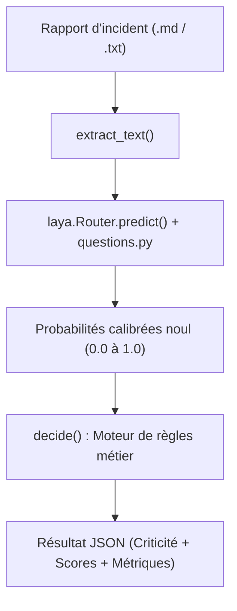

# Inc-Triage

Moteur de qualification et de triage automatique des rapports d'incidents techniques (`.md` ou `.txt`).

Le projet utilise une architecture hybride associant un **modèle d'IA décisionnel « System 1 » (Laya)** pour la perception sémantique probabiliste et un **moteur de règles déterministe** pour la décision finale d'escalade (`CRITICAL`, `MAJOR`, `MINOR`, `REVIEW`).

---

## 1. Fonctionnement du programme



### Inférence & Rôle de la partie « Questions »
Contrairement aux LLM génératifs (GPT, Claude) qui génèrent du texte mot à mot, le moteur repose sur la bibliothèque [Laya](https://github.com/NandhaKishorM/laya) (alternative open-source compatible avec le standard de décision **TypeSafe Jev**, adossée au checkpoint multilingue [convaiinnovations/laya-multilingual](https://huggingface.co/convaiinnovations/laya)) :
- **Inférence non-autorégressive (Zero-Shot) :** Le modèle n'a pas besoin d'entraînement spécifique. En une **seule passe matricielle parallèle** (*single forward pass*), il évalue conjointement l'ensemble des questions sur le texte sans boucle de décodage lente.
- **Schéma déclaratif (`questions.py`) :** Les questions constituent la grille d'analyse du triage. Chaque entrée est de type `noul` (*binary screening*) avec une instruction en langage naturel (ex. : *"L'incident affecte-t-il la production ?"*, *"Existe-t-il une perte de données ?"*).
- **Probabilités calibrées :** Pour chaque question, le modèle renvoie une probabilité $P(\text{vrai}) \in [0.0, 1.0]$ qui reflète la certitude statistique de l'affirmation (proche de 1.0 = affirmation nette, 0.5 = incertitude / non mentionné, 0.0 = négation nette).

### Décision métier & Isolation
- **Moteur de règles (`decide`) :** Les probabilités continues sont confrontées à des seuils d'escalade stricts dans `classify.py` (ex. contrôle de complétude d'information, présence de failles de sécurité, indisponibilité sans contournement).
- **Isolation de sous-processus :** L'inférence est exécutée dans un sous-processus worker. En cas de dépassement de mémoire (OOM-Killer Linux), le processus parent intercepte l'erreur sans crasher et retourne un JSON d'erreur propre, tout en garantissant la libération immédiate de la mémoire RAM et VRAM.

---

## 2. Lancement du programme

### Prérequis
- Python $\ge$ 3.14
- Environnement virtuel configuré (ex. via `uv` ou `venv`)

### Commande d'exécution
Pour classifier un rapport d'incident :
```bash
.venv/bin/python classify.py inc-follow-test.md
```

---

## 3. Exemple de sortie JSON

Le résultat est émis sur `stdout` au format JSON, comprenant le statut, le détail des scores par question et l'empreinte matérielle mesurée (`load_duration_ms`, `inference_duration_ms`, `total_duration_ms`, `ram_peak_mb`, `vram_allocated_peak_mb`) :

```json
{
  "file": "inc-follow-test.md",
  "classification": "CRITICAL",
  "scores": {
    "production": 0.9442,
    "unavailable": 0.9019,
    "wide_impact": 0.9421,
    "no_workaround": 0.9241,
    "data_loss": 0.8117,
    "security": 0.908,
    "sla_risk": 0.8697,
    "sufficient_information": 0.956
  },
  "metrics": {
    "load_duration_ms": 3842.97,
    "inference_duration_ms": 610.86,
    "total_duration_ms": 4576.01,
    "ram_peak_mb": 2772.79,
    "vram_allocated_peak_mb": 1878.67,
    "vram_reserved_peak_mb": 2112.0
  }
}
```

---

## 4. Profilage et Benchmark reproductible (`profile_run.py`)

Pour éviter l'observation visuelle manuelle et obtenir des distributions statistiques précises (**Min, Moyenne, Médiane P50, P95, Max**), utilisez l'outil dédié `profile_run.py`.

### A. Profilage continu haute fréquence (`profile`)
Échantillonne la consommation CPU/RAM (`/proc`) et GPU/VRAM (`nvidia-smi`) toutes les 50 ms pendant toute la durée d'exécution d'un rapport :
```bash
.venv/bin/python profile_run.py profile inc-follow-test.md
```

### B. Benchmark Mode Service / Daemon (`benchmark --warm`)
Simule le comportement d'un **service ou d'une API en production** : le modèle est initialisé une seule fois en mémoire VRAM (~4 s), puis $N$ requêtes d'inférence pure sont évaluées à chaud :
```bash
.venv/bin/python profile_run.py benchmark inc-follow-test.md --warm -n 10
```
Exemple de distribution obtenue sur GPU RTX 3090 :
```text
| Métrique                         | Min       | Moyenne (Mean) | Médiane (P50) | P95       | Max       |
| :---                             | :---      | :---           | :---          | :---      | :---      |
| **Inférence pure Encodeur (ms)** | 170.21 ms | 171.24 ms      | 170.29 ms     | 173.40 ms | 173.85 ms |
```

### C. Benchmark Cold-Start CLI (`benchmark`)
Mesure l'exécution ponctuelle en sous-processus complet (avec chargement initial à chaque appel) :
```bash
.venv/bin/python profile_run.py benchmark inc-follow-test.md -n 5
```

*Ajoutez le flag `--json` sur n'importe quel mode pour exporter directement les statistiques dans un pipeline CI/CD ou d'observabilité.*

---

## 5. Comment entraîner le modèle (Fine-tuning)

Le fonctionnement par défaut en **zero-shot** ne nécessite aucun entraînement préalable. Toutefois, si vos rapports contiennent un jargon interne très spécifique ou des abréviations propres à votre organisation, il est possible d'ajuster le modèle via la CLI native `laya-train`.

### Préparation des données
Préparez un fichier de données étiquetées (`tickets.csv` ou format `.jsonl`) :
```csv
text,label
"Incident Ingress controller sur cluster worker01 DiskPressure...",CRITICAL
"Ralentissement mineur sur consultation historique...",MINOR
```

### Commande de fine-tuning
Lancez l'entraînement à partir du checkpoint multilingue :
```bash
laya-train \
  --data tickets.csv \
  --text-column text \
  --label-column label \
  --base multilingual \
  --out ./checkpoint-incidents
```

### Sous le capot :
- **Optimisation RLCD :** L'entraînement ajuste la tête de décision par apprentissage par renforcement avec des règles de scoring strictes (*strictly proper scoring rules*).
- **Calibration automatique :** Laya réserve 10 % des données pour calibrer la température de sortie, garantissant que les probabilités prédites restent statistiquement fidèles à la réalité.
- **Utilisation du nouveau modèle :** Il suffit ensuite de modifier l'appel dans `classify.py` pour pointer vers votre dossier de checkpoint local (`model="./checkpoint-incidents"`).
